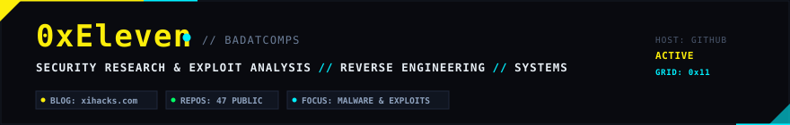

<div align="center">



<br/>

</div>

```
// 0xEleven // SECURITY RESEARCHER & EXPLOIT ANALYST // BLOG: xihacks.com
```

### `> whoami`

Security researcher, reverse engineer, and software developer working across binary analysis, exploit development, malware triage, and web security.

- **Blog & Writeups:** [xihacks.com](https://xihacks.com)
- **Focus Areas:** PE Binary Analysis · Exploit PoCs (CVE Research) · Web Application Security · Offensive Tooling
- **Primary Languages:** Python · JavaScript / Node.js · C / C# · Shell

---

### `// GITHUB TELEMETRY & STATS`

<div align="center">

<a href="https://github.com/0xEleven">
  
</a>
<a href="https://github.com/0xEleven">
  
</a>

<br/><br/>

<a href="https://github.com/0xEleven">
  
</a>

</div>

---

### `// FEATURED REPOSITORIES & RESEARCH`

| Repository | Focus & Description | Primary Stack |
| :--- | :--- | :--- |
| **[PyPEA](https://github.com/0xEleven/PyPEA)** | Portable Executable (PE) analyzer for static analysis, header parsing, and malware triage. | `Python 3` |
| **[CVE-2022-36804-ReverseShell](https://github.com/0xEleven/CVE-2022-36804-ReverseShell)** | Weaponized PoC exploit for the BitBucket Server Critical Command Injection vulnerability. | `Python` |
| **[corspoc](https://github.com/0xEleven/corspoc)** | Demonstration testbed and payload harness for Cross-Origin Resource Sharing (CORS) misconfigurations. ([Live Demo](https://0xeleven.github.io/corspoc)) | `JavaScript` / `HTML` |
| **[web3-voting-app](https://github.com/0xEleven/web3-voting-app)** | Decentralized voting application powered by Web3 and smart contract logic. | `JavaScript` / `Web3` |
| **[OSED](https://github.com/0xEleven/OSED)** | Personal research notes, practice binaries, and exploit scripts for Offensive Security Exploit Developer (EXP-301). | `Assembly` / `C` / `Python` |
| **[SharpCollection](https://github.com/0xEleven/SharpCollection)** | Automated nightly builds of common C# offensive security tools using CI/CD pipelines. | `C#` / `DevOps` |
| **[HikvisionExploiter](https://github.com/0xEleven/HikvisionExploiter)** | Automation utility for vulnerability detection and exploitation (CVE-2021-36260). | `Python` |

---

### `// TECHNICAL SKILLS & TOOLING`

- **Languages:** Python, JavaScript, Node.js, C, C#, Bash, HTML/CSS, Solidity
- **Security & Research:** Reverse Engineering, PE / Static Analysis, Exploit Development, Vulnerability PoCs, Web Application Pentesting
- **Tools & Environments:** Burp Suite, Ghidra, x64dbg/GDB, Git, Linux, Docker, Postman

---

### `// CONNECT & TRANSMISSION`

- **Blog:** [xihacks.com](https://xihacks.com)
- **GitHub:** [@0xEleven](https://github.com/0xEleven)
- **Email:** [mosesateka@gmail.com](mailto:mosesateka@gmail.com)
